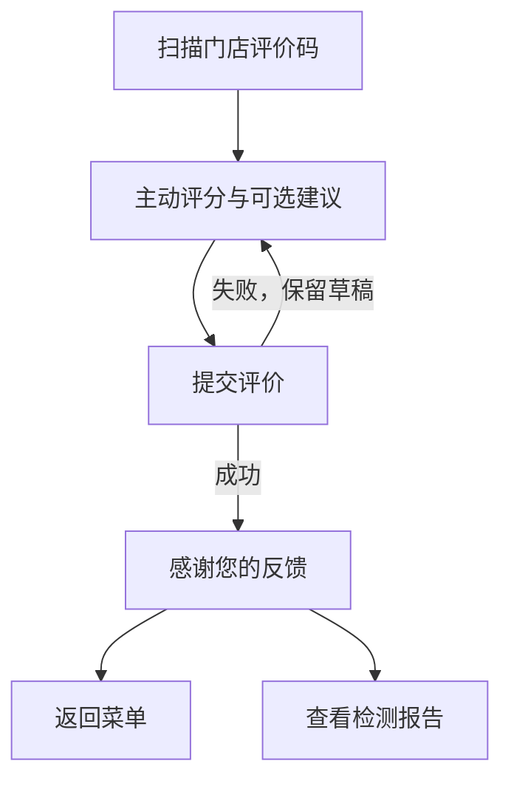

# 到店反馈接口契约 v1

更新日期：2026-10-23

## 0. 门店通用评价入口增量

- `STORE-FEEDBACK-QR-20261023`：新增公开门店入口 `?store=<id>&view=feedback`。紫薇壹号店使用 `store=1`；二维码不含座位、订单、顾客身份或短期提交令牌。
- 顾客扫码直接看到评分及建议表单，不先选座、选项目或登录。评分必须主动选择 1–5 星，无默认分；建议选填，标签与文字限制沿用下文。新入口不创建选单、订单或占用。
- `POST /api/v1/visit-feedback/store-entry` 严格接收 `{store_id}`，仅为已开放门店签发浏览器绑定、12 小时有效的门店级反馈令牌，并返回 `store_id`、`store_name`、`visit_feedback_token`。无效或未开放门店拒绝。公开链接不是物理到店证明。
- 门店级令牌使用独立版本/签名域，不带服务位或二维码记录，不可转换为旧服务位入口凭证。服务端提交时再次校验门店开放状态、有效期及浏览器 Cookie；仅由令牌决定门店。
- 提交复用 `POST /api/v1/visit-feedback`，持久化为 `source=store_qr`、`room_id=null`、`service_position_qr_id=null` 的 `visit_feedback`。不关联订单、选单或技师，不计入技师评分；后台仍按本店权限读取和跟进。
- 门店级幂等指纹、数据库串行锁及每小时 5 条限流均包含门店范围；同身份复用同键但跨店或改内容必须拒绝，不覆盖原记录。旧服务位记录指纹及幂等重放保持兼容。
- 新入口无须登录；若调用方提供 Authorization，则仍须有效，不能把无效登录凭证静默降为匿名。响应不泄露其他反馈或顾客资料。
- 提交失败保留草稿；相同内容重试复用幂等键，提交中防重复点击。成功后不自动跳转，显示「返回菜单」与「查看检测报告」两个按钮，分别进入本店 `view=menu` 与 `view=reports`；均不携带座位参数。报告中心沿用既有本人手机号登录流程，不走 `view=return` 自动打开原站。
- 迁移只放宽 `visit_feedback.room_id` 的空值约束，不改写或删除旧数据。降级遇到无座记录必须拒绝，不得删记录强行恢复非空约束。
- 下文的签名服务位二维码与 `vf1` 规则仍适用于原服务位入口。新增门店通用评价码不替代选购服务位码、不放宽服务评价的所有权或结束状态验证。

### 顾客流程



## 1. 两类反馈

- `service_review`：沿用 `POST /api/v1/selection-sessions/{id}/feedback`。必须持有原选单凭证或本人登录凭证，并且服务已经权威结束；同一选单最多一条。不得放宽这一接口的所有权、结束状态或唯一约束。
- `visit_feedback`：使用 `POST /api/v1/visit-feedback`。它是独立持久化的到店体验反馈，不依赖选单、订单或服务状态，不关联技师，也不纳入技师评分。
- 服务位、当前占用、提交时间和二维码只能证明到店门店及入口，不能用于推断选单、订单、顾客自然人或技师。
- 每个门店的每个实际服务位各有一张签名二维码；不是每店共用一张码。匿名与登录顾客扫码后首屏直接进入项目菜单，通过菜单内次级「评价与建议」入口提交独立到店反馈。
- 后台批量打印从本店服务位接口的真实启用 `sofa`/`bed` 记录生成二维码，不依赖顾客可否自行选择该床位，也不使用页面为缺失服务位补齐的占位记录；空间容器和停用服务位不打印。打印物料按真实服务位编码逐张核对后才能投放。
- 2026-09-22 新事实：门店尚未张贴任何二维码，不存在需要兼容的无签名历史印刷码。签名只证明"经过有效入口"，不宣称顾客物理在店。

## 2. 提交到店反馈

### 请求

`POST /api/v1/visit-feedback`

请求头：

- `Idempotency-Key`：必填，8–128 个可打印 ASCII 字符。同一次提交的网络重试必须复用；新的提交意图必须生成新值。
- `Authorization: Bearer <token>`：可选。提供时必须有效；失效令牌不得静默降级为匿名。
- 现有 `POST /api/v1/entry-sessions` 成功响应包含 `visit_feedback_token`（可空）。该令牌由服务端根据已经验证的签名二维码入口签发，12 小时有效并绑定门店、服务位、入口来源和当前 HttpOnly `hxy_browser_token`。生产环境中只有携带并通过 v2/v3 签名 `entry_token` 验证的进入才会签发；未经签名验证的 `store_qr` 进入可以继续选位选购，但响应的 `visit_feedback_token` 为 `null`，客户端不得据拼接参数自行构造反馈凭证。非生产环境保留未签名进入的签发以便联调。既有正式二维码物料无需重印；门店尚未张贴二维码，无无签名旧码需要兼容。
- `POST /api/v1/visit-feedback/entry` 接收签名床位码中的 `store_id`、`position_code`、`source=personal_qr|room_qr` 和 `entry_token`。服务端核验这四者属于同一个启用的二维码及服务位，返回 `visit_feedback_token`、门店 ID、服务位编码和展示标签，设置同站 HttpOnly 浏览器 Cookie。此调用不创建选单、订单或占用；床位已被使用时仍可评价。无效、停用、跨店或错床位的码不得换取凭证。
- 新短链接二维码只负责解析并跳转到上述签名入口，不直接签发反馈令牌；短码停用或轮换后无法继续换取 v3 入口。反馈令牌的浏览器、二维码、门店和服务位绑定不变。
- 顾客端扫描床位码后直接调用 `POST /api/v1/entry-sessions` 进入菜单；响应同时提供可空的到店反馈令牌。评价入口不读取共享选单或他人订单，令牌过期续期仍只调用独立到店入口。
- 未登录时使用现有 HttpOnly `hxy_browser_token` 作为第一方匿名浏览器身份；登录提交仍须携带同一浏览器 Cookie。它不等于手机号账号或自然人身份。
- 顾客端入口响应类型必须保留 `visit_feedback_token: string | null`；空令牌不能用于提交，也不能当作续期成功。续期失败保留评价草稿并提示重新扫描可信二维码。
- 生产签发的反馈令牌绑定本次验证通过的二维码记录 ID；该码被停用、换新或改绑后，旧反馈令牌立即失效。同服务位的新码不能继承旧码的反馈令牌。

请求体严格拒绝额外字段：

```json
{
  "visit_feedback_token": "vf1.server-signed-entry-context",
  "rating": 5,
  "tags": ["手法专业", "环境舒适"],
  "note": "本次到店体验很好"
}
```

- `rating`：显式选择的整数 `1`–`5`，无默认值。
- `tags`：最多 3 项，必须属于当前评分分组：
  - 4–5 星：`手法专业`、`力度合适`、`沟通细致`、`环境舒适`、`整体放松`
  - 3 星：`手法一般`、`力度需调整`、`沟通可更清楚`、`环境一般`、`项目预期不一致`
  - 1–2 星：`力度不合适`、`沟通体验不好`、`等待较久`、`环境问题`、`项目与预期不符`、`其他问题`
- `note`：可选文本，去除首尾空白后最多 300 字。
- 客户端不得提交 `store_id`、服务位、`customer_id`、选单、订单或技师。服务端从签名到店反馈令牌解析并校验门店、服务位、来源和浏览器绑定。

### 成功响应

首次提交与相同键、相同请求体的幂等重放均返回 HTTP 200：

```json
{
  "id": 123,
  "feedback_type": "visit_feedback",
  "rating": 5,
  "tags": ["手法专业", "环境舒适"],
  "note": "本次到店体验很好",
  "submitted": true,
  "created_at": "2026-09-21T12:00:00Z"
}
```

响应不返回其他反馈、手机号、匿名 Cookie、顾客 ID、选单、订单或技师信息。

### 错误

- `400 FEEDBACK_TAG_INVALID`：标签不属于当前评分分组。
- `400 IDEMPOTENCY_KEY_INVALID`：幂等键缺失或格式非法。
- `401 SESSION_REPLACED` 或登录失效：提供的登录凭证无效。
- `403 VISIT_FEEDBACK_TOKEN_INVALID`：令牌签名、浏览器绑定或门店/服务位状态无效，须重新扫码进入。
- `403 VISIT_FEEDBACK_TOKEN_EXPIRED`：12 小时入口令牌已过期，须重新扫码进入。
- `409 IDEMPOTENCY_KEY_REUSED`：同一身份复用相同键但请求体不同，原记录不被覆盖。
- `422`：评分、标签数量、文本长度或额外字段不符合严格请求结构。
- `429 FEEDBACK_RATE_LIMITED`：同一服务端身份和二维码在滚动一小时内超过 5 条；响应带 `Retry-After`。

幂等唯一性和限流均由共享数据库执行，不能只依赖单进程内存或前端按钮状态。

## 3. 管理端

- 管理端反馈列表、详情和处理操作必须按员工授权门店隔离，并明确返回 `feedback_type`。
- `visit_feedback` 显示为“到店反馈”，`selection_session_id` 为 `null`，不得展示订单或技师入口。
- `service_review` 显示为“服务评价”，保留其明确选单关联。
- 两类反馈可以复用 `open | in_progress | resolved | dismissed` 处理状态及审计，但不得承诺自动回访。
- 到店反馈可以计入明确命名的门店体验统计；现有选单转化漏斗和任何服务/技师指标只能统计 `service_review`。
